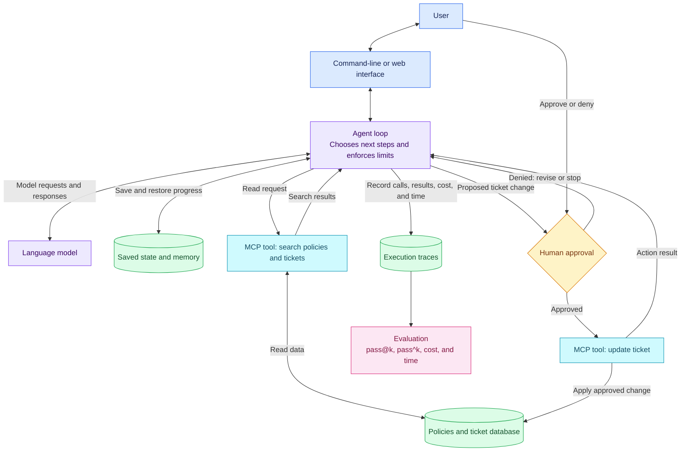

# EE 599: Agentic Application Project

**Draft · Fall 2026 · Individual project; no teams**

Build an AI-agent application for a specific user and task. The agent must use tools, choose actions based on what it finds, and produce a result the user can check. Measure how well it works, make one change based on the results, and measure it again.

Choose a small problem you can finish within the course workload. A command-line interface, notebook, or simple web interface is sufficient. You may extend your own assignment code. Add multiple agents, document retrieval, browser automation, or image/audio inputs only when they help with your task.

## Getting started

Create your own repository using Python 3.11 or newer and Git. Document package installation, configuration, and commands to run the application, tests, and evaluation. Keep passwords and API keys out of Git. Provide an `.env.example` with placeholder values for any required environment variables.

## Choose a subject and explore examples

Choose an option below or propose your own. Explain who will use it, what task it will complete, and why the agent needs to choose actions as it works.

The linked examples provide implementation ideas. Choose a smaller scope for your project. Some use frameworks beyond those taught in class; you can apply their ideas using the course tools. You must still implement and evaluate the course requirements.

| Subject | What the application could do | How you could check success | Example to explore |
|---|---|---|---|
| Research assistant | Investigate a narrow question, search sources, and write a brief with citations. | Sources support the claims; citations are accurate; missing evidence is identified. | [LangChain: Deep research agent](https://docs.langchain.com/oss/python/deepagents/deep-research) |
| Coding assistant | Investigate an issue in a small repository, propose a patch, and run tests. | Relevant tests pass; changes address the issue without breaking existing behavior. | [mini-SWE-agent](https://github.com/SWE-agent/mini-swe-agent) |
| Data analysis assistant | Inspect a public dataset, choose analysis steps, run code, and explain results. | Calculations are correct; another person can repeat the analysis; missing data is handled. | [LangChain: Data analysis agent](https://docs.langchain.com/oss/python/deepagents/data-analysis) |
| Course or lab assistant | Read documentation, diagnose a setup problem, and guide troubleshooting. | Diagnosis and steps are useful; the agent asks for help when it lacks evidence. | [Hugging Face: Agentic RAG](https://huggingface.co/docs/smolagents/examples/rag), adaptable to course materials |
| Service request assistant | Read policies, ask for missing information, and update a simulated ticket after approval. | Decisions and updates follow policy; approval is required before an update. | [LangChain: Customer support with handoffs](https://docs.langchain.com/oss/python/langchain/multi-agent/handoffs) |
| Trip or event planner | Gather user requirements, compare options, and revise an itinerary. | Schedules are feasible, costs are correct, and the plan meets user requirements. | [TravelPlanner](https://github.com/OSU-NLP-Group/TravelPlanner), including evaluation code |

Use public or made-up data. You may simulate external services and run actions in a local test environment.

## Application requirements

Your **first version** must:

- Complete one useful task from user input to a result the user can check.
- Use at least two useful tools, with at least one capability connected through Model Context Protocol (MCP), the standard introduced in class.
- Track progress in explicit state, such as completed steps and tool results. Check tool arguments, handle tool errors, and stop when a step or cost limit is reached.
- Save an execution trace: a record of model calls, tool calls, and their results. Record cost and elapsed time as well.
- Require human approval before a tool sends a message, spends money, or changes or deletes user or external data. You may demonstrate this with simulated services.

Your **final version** must also:

- Save progress and resume after an interruption without repeating completed external actions.
- Implement one memory rule: explain what information is kept across runs and how it can be corrected or deleted.
- Use a trace from a failed run to choose one change. Test the change and keep or undo it based on the results.
- Explain what the application can access or change, how it handles prompt injection (instructions hidden in outside content), and what risks remain.

Use the course tools or check with the instructor before choosing alternatives.

## Architecture block diagram

Include a block diagram of your system architecture with the first version. Show the user interface, agent and model, tools and MCP connections, data sources, saved state or memory, and human approval points, as applicable. Label arrows to explain how information and actions move between components. Update the diagram for the final submission so it matches your implementation.

Here is an example for a service-request assistant. Draw the components your own application actually uses.

## Required evaluation

**Evaluation is required.** Test whether the complete application takes appropriate actions and produces correct results.

1. **Define tasks and success criteria.** Submit at least 10 cases for the first version and 20 for the final version. Each needs an input, starting data and state, and an expected outcome or scoring guide. Set a binary PASS/FAIL rule before running each case, including a score threshold if needed. Include ordinary tasks, unclear requests, missing information, and tool failures. Final cases must also test denied approval, interruption and recovery, and malicious instructions in outside content. A required approval or safety check being bypassed makes that trial FAIL even if the final answer is correct.
2. **Compare with a simpler approach.** Your baseline could be a single model call or fixed sequence of steps. Explain its access to information and tools. Record model settings and step or spending limits so readers can assess the comparison.
3. **Measure results and effort.** Use metrics from Session 6, including `pass@k` (at least one of k attempts succeeds) and `pass^k` (all k attempts succeed), to evaluate capability and reliability. State your chosen k and the number of trials per case. Also report relevant quality scores, approval and recovery results, cost, and elapsed time. Automate checks where possible. If a model scores outputs, submit its instructions and scoring guide, manually check at least five judgments, and report disagreements.
4. **Check improvement on unfamiliar tasks.** Reserve at least five final cases that you do not use to adjust the application. Finalize the test set before comparing the baseline, first version, and final version. Evaluate all three on the same cases, with the same graders, starting conditions, and trial budgets.
5. **Explain failures.** Use traces to analyze at least two failed cases. Show results before and after your chosen change, including any tasks that became worse or stayed the same.

Submit cases, evaluation code, saved results, and a command to repeat the evaluation. Reset starting data, state, and memory before each independent trial. Count failures and timeouts. Save or version source data where possible, identify required live services, and estimate costs before large runs.

Tool and control-logic tests may use fixed responses offline. Evaluation of the complete application must also use an actual model, hosted or local. Identify the model and label simulated results. Report tokens processed and elapsed time for local models, even without an API charge.

## Deadline timeline

The project has **two required submissions through the course learning-management system (LMS): the first version on November 8 and the final version on December 12**. The first version is required but ungraded; you will receive feedback to guide your revisions. The final version and your **recorded video presentation, shown in class on December 4**, determine your project grade. Progress checks between submissions provide informal feedback during class and require no separate upload.

| Date or period | Deliverable |
|---|---|
| **November 8, 2026** | **First version:** a working application and a plan of at most one page identifying the title, intended user, task and scope, tools, baseline, and evaluation metrics. **Provide supporting materials separately:** at least 10 cases with PASS/FAIL rules, initial evaluation results and a baseline comparison, an architecture block diagram, setup and evaluation instructions, analysis of two failed cases, and an improvement plan. Save a Git tag marking this version. |
| **November 9–December 3, 2026** | **Progress checks and refinement:** demonstrate saved progress, recovery after interruption, memory across runs, and approval behavior. Prepare draft final results and revise the threat model to describe possible attacks, defenses, and remaining risks. Include findings from the class security exercise. |
| **December 4, 2026 — in class** | **Recorded video presentations:** we will show your prerecorded three-minute videos in class. Upload yours to YouTube as Unlisted and add the link to your project README before class. |
| **December 12, 2026** | **Final version:** repository another person can run, updated architecture block diagram, at least 20 evaluation cases, evaluation code and saved results, metric comparisons including `pass@k` and `pass^k`, example traces, presentation materials and YouTube video link, and a report of at most four pages excluding references. |

Submit both versions through the LMS. Include planning work and progress-check results in these submissions as appropriate.

## Presentation format: recorded video

**Your presentation must be a prerecorded video, with a maximum length of three minutes. The video is your presentation; no separate live presentation is required.** Upload it to YouTube with visibility set to **Unlisted** and add the link to your project README before the December 4 class, when we will show the videos. Include the link in your December 12 final LMS submission as well; no separate LMS upload is required for the presentation.

Suggested structure:

- **0:00–0:30:** identify the user and task.
- **0:30–1:00:** explain your architecture block diagram.
- **1:00–2:00:** demonstrate the application completing a task.
- **2:00–3:00:** show evaluation metrics such as `pass@k` and `pass^k` against the baseline, cost and time, one failure or limitation, and your contribution beyond any samples you used.

Use readable screen recordings and clear narration. Check that the link plays in a signed-out or private browser window, and keep the video available through grading. See [YouTube's visibility instructions](https://support.google.com/youtube/answer/157177) for setting a video to Unlisted.

## Grading and submission

The first version receives feedback and is **not graded**. The **final project, including the recorded video presentation, counts for 60% of the course grade**; programming assignments account for the remaining 40%. The final project is graded on:

- **30%:** whether the application works and its design fits the task.
- **30%:** evaluation quality and explanation of results.
- **20%:** reliability, human control, and security.
- **20%:** whether another person can run the work and understand your explanation.

The recorded video presentation contributes to these criteria as part of the final-project grade.

Evaluation is graded on sound methods, results others can reproduce, and honest interpretation. You can earn full credit even if tasks fail or your change does not improve results.

Another person must be able to run a fresh copy of your repository using your instructions and sample data. Follow the syllabus AI-use and data policies. Be able to explain and modify your code.

Include the syllabus verification note in three bullets: models used; how you tested the work; and one known failure or limitation (or “none found”). Include the comparison with sample projects described below in your first-version README and final report.

For both required submissions, push your work and submit the repository URL, exact commit hash, and materials listed in the timeline through the LMS. Check that the instructor can access everything.

## Explain your contribution

**Clearly explain how your project differs from the samples.** In your first-version README and final report, include a short section titled **“Comparison with sample projects”** that answers:

- **What did you use?** Link to the samples that informed your work, including sources outside this list. Identify reused code or components, and distinguish code reuse from ideas you studied.
- **What is different?** Describe specific changes to the task, data, tools, workflow, approval rules, recovery, or evaluation. State which parts still follow the sample.
- **What did you contribute and test?** Point to the files or functions you added or changed. Explain how your test cases and results demonstrate the behavior you implemented.

Running a sample unchanged or changing only its name or interface is insufficient. Your contribution must implement and test behavior relevant to your chosen task. If no sample fits your project, explain your approach and identify any other starting code you used.

## References and useful resources

These resources are optional. Choose those that help with your subject. The industry case studies describe larger systems than this project requires.

- [Building Effective Agents — Anthropic](https://www.anthropic.com/engineering/building-effective-agents): start here for workflow choices, tool design, and support/coding application examples.
- [ReAct — Yao et al.](https://arxiv.org/abs/2210.03629): how a model alternates between choosing actions and using the information those actions return.
- [How We Built Our Multi-Agent Research System — Anthropic](https://www.anthropic.com/engineering/multi-agent-research-system): search, citations, evaluation, and cost tradeoffs in a research-assistant case study.
- [Raising the Bar on SWE-bench Verified — Anthropic](https://www.anthropic.com/engineering/swe-bench-sonnet): a coding-agent case study showing how tools and the execution loop affect results.
- [OpenAI Agents SDK](https://openai.github.io/openai-agents-python/): documentation for agents, tools, passing tasks between agents, and recording runs.
- [LangGraph Overview](https://docs.langchain.com/oss/python/langgraph/overview): managing state, saving progress, and pausing for human input.
- [MCP Architecture](https://modelcontextprotocol.io/docs/learn/architecture): how hosts, clients, servers, tools, and resources fit together.
- [Evaluate Agent Workflows — OpenAI](https://developers.openai.com/api/docs/guides/agent-evals): guidance and tools for evaluations that can be repeated.
- [Evaluating Large Language Models Trained on Code — Chen et al.](https://arxiv.org/abs/2107.03374): evaluating success across multiple attempts with `pass@k`.
- [τ-bench — Yao et al.](https://arxiv.org/abs/2406.12045): evaluating tool-using agents and repeated success with `pass^k`.
- [Reflexion — Shinn et al.](https://arxiv.org/abs/2303.11366): using feedback and saved reflections to improve later attempts without training model weights.
